

  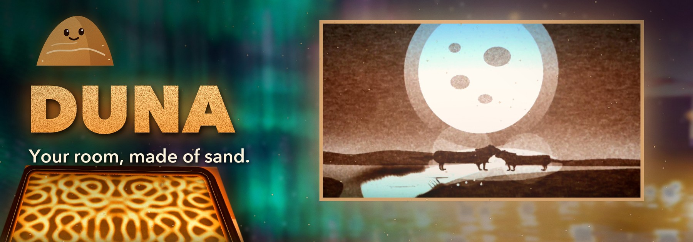

  <h1>DUNA</h1>
  
<strong>Your room, made of sand.</strong>

  
<em>500+ sand art shows that pour into your real room, dance to the music, and let your bare hands catch the magic. The creature you catch becomes the star of your ending.</em>

  

    
    
    
  

  

    
    
    
    
    
    
    
    
  

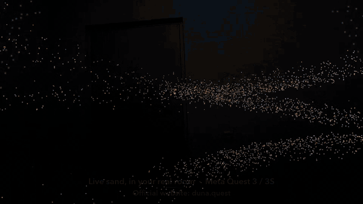

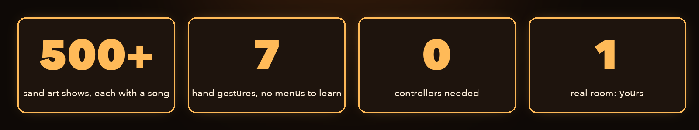

## What it is

Press play on the glowing **Light Box** and sand rains into your real room. The board turns into a cymatics plate that dances to every note, a 3D sand floor ripples with the beat, and a sand artist draws the story live across your real wall. A creature flies out of the picture: catch it with both hands and keep it as **Glass**. The creature you keep comes back as the star of the ending: your wall turns to sand and breaks open, and it leads you into its world, where you point a finger to fly.

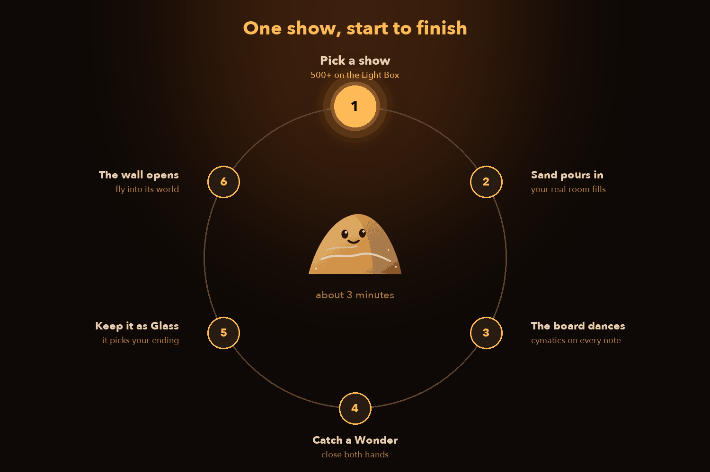

<table>
  <tr>
    <td width="33%">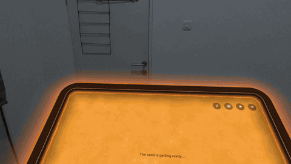 <strong>Sand pours in</strong></td>
    <td width="33%">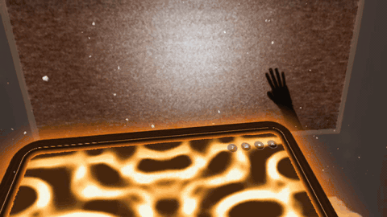 <strong>The board dances</strong></td>
    <td width="33%">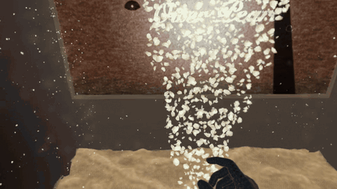 <strong>A 3D sand floor on the beat</strong></td>
  </tr>
  <tr>
    <td width="33%">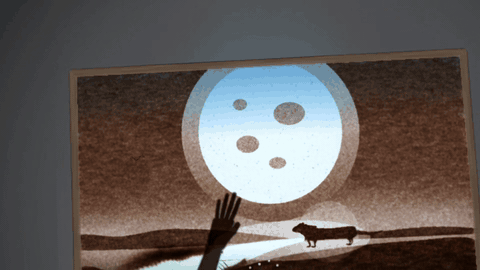 <strong>Drawn live on your wall</strong></td>
    <td width="33%">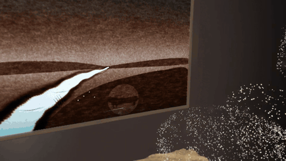 <strong>Catch it, keep it as Glass</strong></td>
    <td width="33%">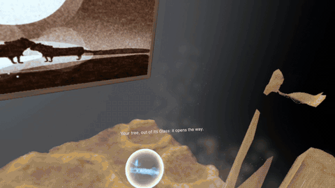 <strong>Your catch leads the ending</strong></td>
  </tr>
  <tr>
    <td width="33%">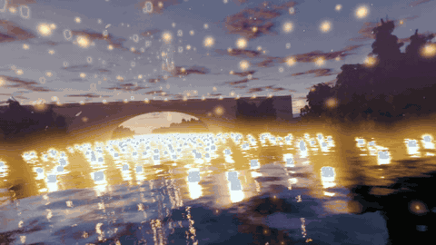 <strong>Point a finger to fly</strong></td>
    <td width="33%">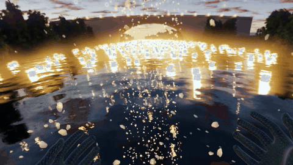 <strong>Everything reacts to your hands</strong></td>
    <td width="33%">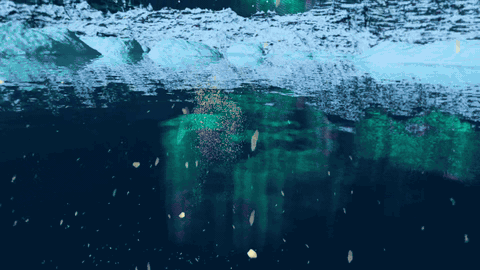 <strong>Endings you choose</strong></td>
  </tr>
</table>

### The Sandbox

| Draw in real 3D sand | Pour from your fist |
| --- | --- |
| 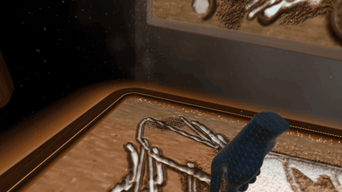 | 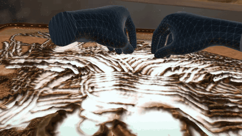 |

Draw with one finger, gather five fingertips to photograph something real and turn it into sand art, place figures on a timeline, record your voice, choose the ending, and play it back as your own show.

## How it works

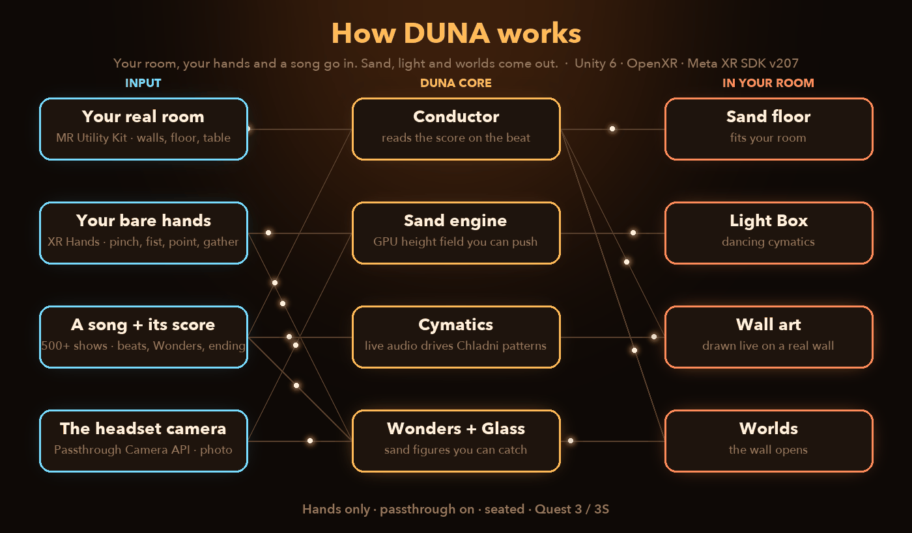

| Meta capability | In DUNA |
| --- | --- |
| **MR Utility Kit** (scene understanding) | Walls, floor, tables, couch and bed: the art lands on a real wall, the sand floor fits the room, the wall opens onto a World |
| **Passthrough** | Always on; dimmed during a show like a cinema |
| **Hand tracking** (Unity XR Hands) | Touch, draw, pour, catch, point, gather, reach. No controllers anywhere |
| **Passthrough Camera API** | The five-finger photo that becomes sand art |
| **Spatial audio + microphone** | Music around you; your own voice in your pieces |

---

<strong>Official website: <a href="https://duna.quest">duna.quest</a></strong> Made by a solo developer in Jakarta, Indonesia, for the Meta VR Start Developer Competition 2026.

