

  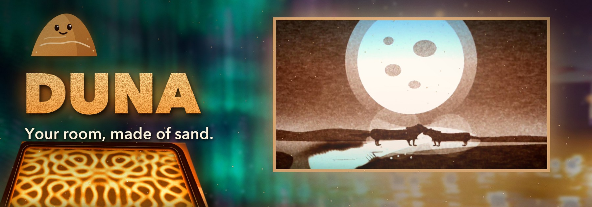

# DUNA

## Your room, made of sand.

**DUNA** turns your real room into a stage for **500+ sand art shows**. Press play and sand rains onto your floor, the table glows and dances to every note, and a story is drawn live across your wall. Catch what flies out with your bare hands. The one you keep opens your wall into another world.

  
  
  
  
  

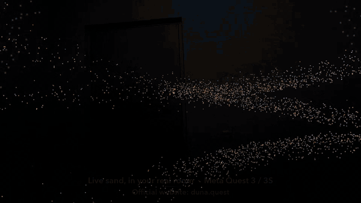

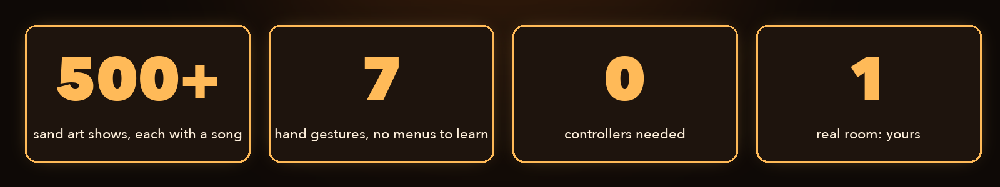

## Inspiration

I love watching sand artists. A light box and two hands turn a pile of sand into a moving story, but you only ever see it on a screen, far away. I wanted the sand in **my** room, moving to the music, close enough to touch.

## What it does

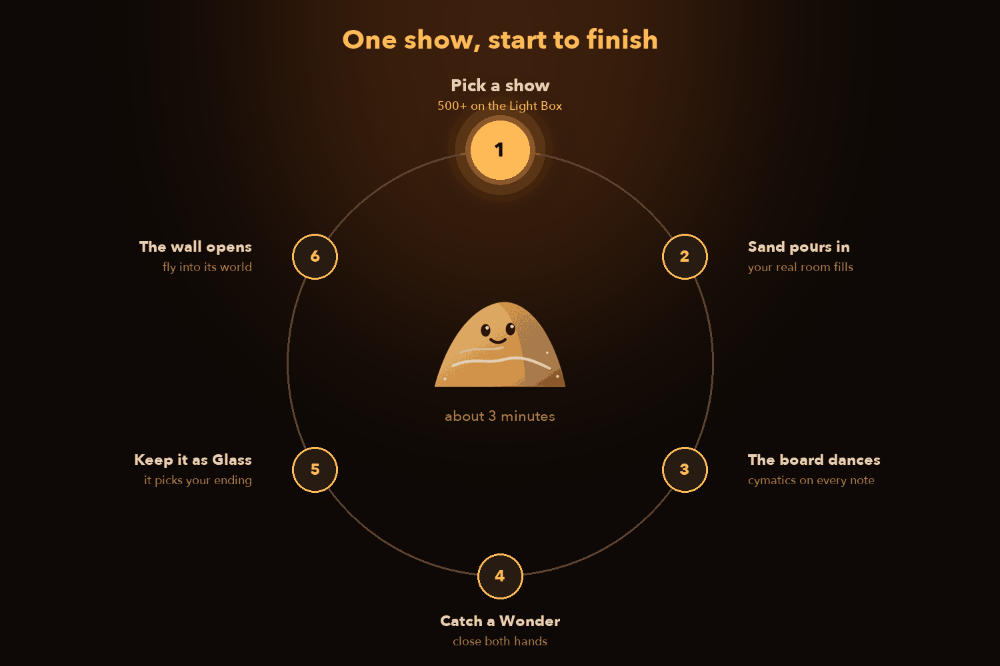

<table>
  <tr>
    <td width="50%">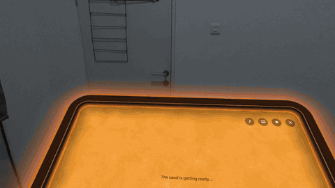 <strong>Sand pours in.</strong> Your room fills, then a sand figure rises.</td>
    <td width="50%">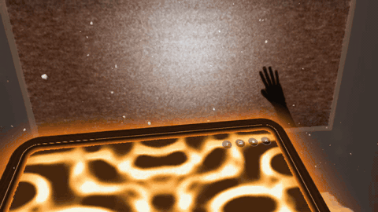 <strong>The board dances.</strong> Live audio draws real Chladni patterns.</td>
  </tr>
  <tr>
    <td width="50%">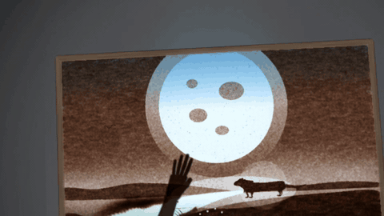 <strong>Drawn live on your wall.</strong> Frame by frame, like a sand artist.</td>
    <td width="50%">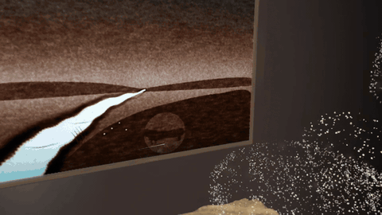 <strong>Catch it, keep it.</strong> Close both hands: it becomes Glass.</td>
  </tr>
  <tr>
    <td width="50%">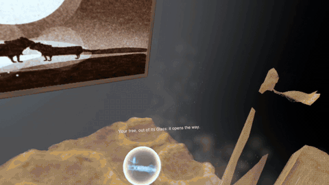 <strong>Your Glass opens the wall</strong> into its world.</td>
    <td width="50%">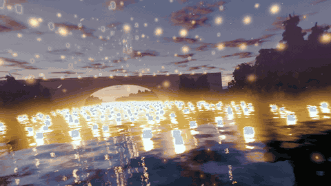 <strong>Point a finger to fly</strong> through the lanterns.</td>
  </tr>
</table>

### Sandbox: make your own show

| Draw in 3D sand | Pour from your fist | Your own ending |
| --- | --- | --- |
| 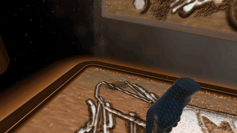 | 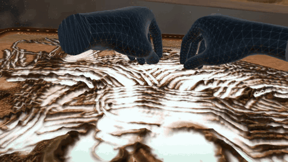 | 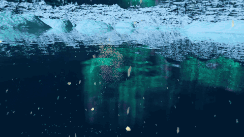 |

Draw with a finger, gather five fingertips to photograph something real and turn it into sand art, place figures on a timeline, record your voice, pick an ending, then play it back like any show.

## How we built it

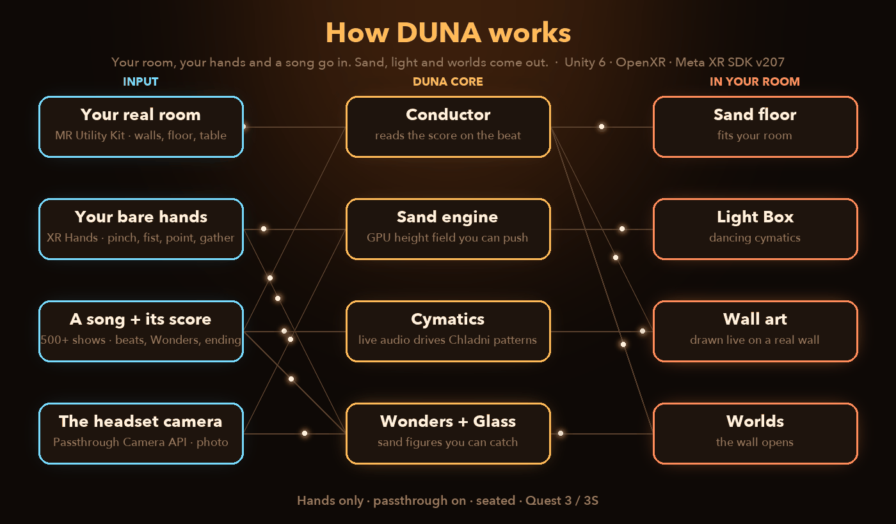

| Meta capability | How DUNA uses it |
| --- | --- |
| **MR Utility Kit** | Finds walls, floor, tables and couches. The art lands on a real wall and the sand floor fits your room. |
| **Passthrough** | You stay in your room. It dims during a show, like a cinema. |
| **Hand tracking** (XR Hands) | Seven gestures: touch, draw, pour, catch, point, gather and reach. Our own pose reader prevents accidental triggers. |
| **Passthrough Camera API** | The five-finger photo that becomes sand art. |
| **Spatial audio + mic** | Music around you; your voice recorded into your pieces. |

Unity 6, URP, OpenXR and Meta XR SDK v207. The sand is a GPU height field. A score file per song conducts the Wonders on the beat, and build-time tools generate and check the whole library.

## Challenges

Thousands of grains, a pushable sand surface and a full world at once on a standalone headset. Gestures that feel natural but never fire by accident. Rooms we have never seen.

## What's next

- New shows every week.
- Share your Sandbox shows.
- Watch together in shared mixed reality.
- More worlds and seasonal events.
- Launch on the Meta Horizon Store.

  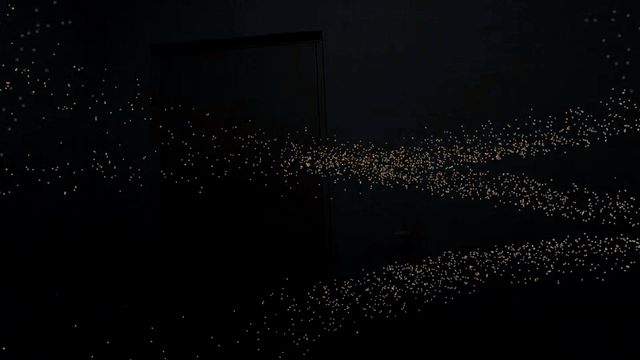 
  <strong>Official website: <a href="https://duna.quest">duna.quest</a></strong>

